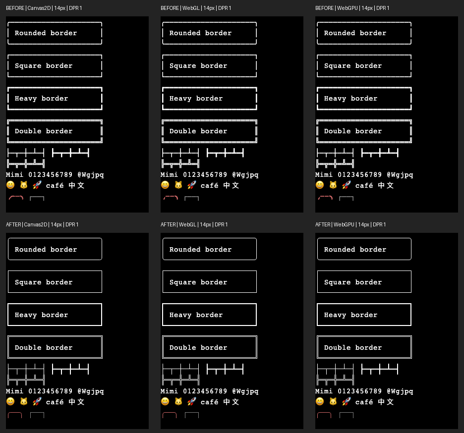
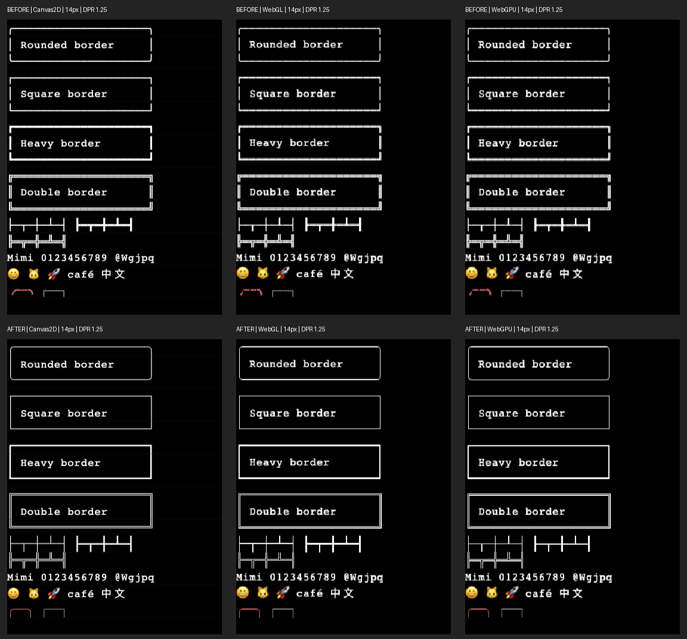

# Box-drawing continuity investigation

Reproduced using `demo/box-drawing-check.html`, with the requested rounded and square borders plus heavy/double borders, junctions, styled borders, ordinary text, CJK, and color emoji. Baseline: `9bf520481a423aa1a38ffd1eca2ef82b66faeeb2`. Browser: Chrome 156.0.8078.73, macOS arm64. All three requested backends initialized successfully: Canvas2D, WebGL2, and WebGPU.





The confirmed primary cause is a mismatch between font ink and terminal cell dimensions. Booba's default stack resolved to Courier for Latin, Menlo for box drawing, and Apple Color Emoji for emoji on this machine. Resolution was inspected using Chrome's `CSS.getPlatformFontsForNode` on individual DOM glyph probes with exactly the same font settings as the canvas, alongside canvas `measureText` metrics. Browser canvas APIs do not directly expose the selected fallback font.

At 14 px, `measureText('M').width` is 8.4013671875 and `Math.ceil` makes the column 9 px. Menlo's `─` ink extends from -0.13671875 to 8.5654296875: only 8.7021484375 px, leaving about 0.298 px between adjacent Canvas2D glyphs. GPU rasterization crops the negative left overhang at the slot boundary, leaving about 0.435 px. Both display a repeating seam. The font advance is not a promise that the ink covers the terminal's rounded advance.

The row is 22 px high, with baseline 16: the emoji sample contributes ascent 15 and descent 5, plus the existing two pixels of padding. Menlo's `│` ink spans 17.841796875 px vertically, leaving about 4.158 px between rows. The two pixels of padding contribute, but removing them alone would not fix continuity; the emoji-safe line box is also taller than the border glyph. The glyph fits vertically inside the atlas slot, so vertical atlas clipping is not the original cause. Placement at `column * cellWidth` and `row * cellHeight + baseline` is consistent across backends. Changing advance, padding, or baseline would change ordinary text spacing, emoji clearance, or fitted terminal dimensions.

The fix adds shared cell geometry in `lib/box-drawing.ts`. Canvas2D draws that geometry directly using the current foreground and alpha. The shared GPU atlas rasterizes the same geometry as a white coverage mask, retaining existing shader coloring, selection, inverse, faint, and cursor behavior. Light/heavy segments reach the cell edges; double rails preserve hollow corners and junctions; rounded corners use quadratic curves. A single filled path avoids accumulating faint alpha where straight segments overlap. Bold and italic do not deform these geometric glyphs; the Unicode character determines weight. Ordinary text, emoji, and grapheme clusters retain their font rendering paths. Cell measurement and dimensions are unchanged.

Pixel testing exposed an additional GPU issue at fractional DPR: an interpolated UV at a cell edge could sample the next packed atlas slot. At DPR 1.25 this produced a dim vertical seam even with cell-filling geometry. WebGL and WebGPU now clamp glyph reads to the current slot's half-texel bounds. Both use nearest sampling; this prevents neighboring-slot bleed without changing glyph size or grid placement.

Validation covers font sizes 12, 14, 15, 18, and 24 px; DPR 1, 1.25, and 2; all three backends; booba's default stack and explicit Menlo. All 90 source cases pass. Another 45 default-stack cases pass against the regenerated production bundle. Automated PNG checks require foreground coverage in every device column/row along all four border families, including cell seams. Ordinary text and emoji row interiors are byte-identical to baseline, and cell metrics and canvas dimensions are unchanged. The interiors exclude two device pixels at each neighboring row boundary to avoid counting the intentionally changed border ink. The preserved metric values and font probes are in `validation.json`; raw captures remain in `.vite/box-drawing/`.

Focused Bun coverage checks edge coverage, hollow double junctions, rounded endpoints, one fill per straight glyph, unsupported/combining fallback, and the shared atlas's geometry-versus-text dispatch. The complete ghostty-web suite passes: 561 tests. Typechecking and lint pass. Formatting passes for changed files; repository-wide `bun run fmt` reports the pre-existing `.github/workflows/build.yml` formatting issue. Booba's 162 TypeScript tests and `go test ./...` pass.

Reproduce from the ghostty-web directory with Vite running (`bun run dev`). Install Playwright in your development environment, or set `PLAYWRIGHT_MODULE` to an existing installation's entry point. Chrome must be available. Explicit unavailable GPU backends cause the fixture to fail rather than silently counting a fallback as validation.

```sh
node bench/box-drawing-check.mjs before 9bf520481a423aa1a38ffd1eca2ef82b66faeeb2
node bench/box-drawing-check.mjs after
node bench/box-drawing-assert.mjs
BOX_FONT=Menlo node bench/box-drawing-check.mjs before 9bf520481a423aa1a38ffd1eca2ef82b66faeeb2
BOX_FONT=Menlo node bench/box-drawing-check.mjs after
BOX_FONT=Menlo node bench/box-drawing-assert.mjs
bun run build:lib
bun run build:wasm-copy
node bench/box-drawing-check.mjs bundled
node bench/box-drawing-assert.mjs bundled
```

The JavaScript distribution was regenerated with the normal `build:lib` target and the unchanged WASM copied with `build:wasm-copy`. No Zig/WASM source change was needed. From booba's root, `task build-serve-assets` refreshed the embedded assets; the copied JavaScript is byte-identical to `dist/ghostty-web.js`. Generated JavaScript was not hand-edited.

Scope is deliberately limited to these 37 characters: `─│┌┐└┘├┤┬┴┼`, `━┃┏┓┗┛┣┫┳┻╋`, `═║╔╗╚╝╠╣╦╩╬`, and `╭╮╰╯`. Mixed-weight, dashed, diagonal, half-line, and combining forms still use font glyphs and may retain spacing gaps. Canvas2D and GPU curve antialiasing can differ, particularly at fractional DPR, because the GPU atlas retains its existing CSS-pixel raster resolution. Validation was on Chrome/macOS, not every browser, operating system, or GPU. Source and rebuilt distribution changes are local in the ghostty-web submodule; publishing the fork and advancing booba's gitlink remain separate release steps.
